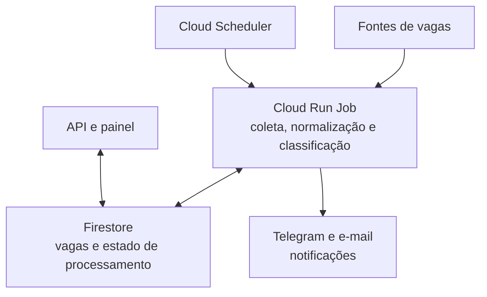

# Job Hunter — estudo de caso

Uma plataforma pessoal para coletar, organizar e priorizar oportunidades de infraestrutura, Cloud, DevOps e SRE. O projeto combina automação em Python com serviços gerenciados do Google Cloud para executar buscas agendadas, manter o histórico e enviar alertas das vagas que merecem atenção.

> Este repositório apresenta a arquitetura, decisões e evidências do projeto Job Hunter. O código completo e o ambiente de produção são privados.

## O problema

Buscar vagas em várias fontes dá trabalho e facilita perder oportunidades. O Job Hunter automatiza parte desse fluxo: consulta fontes configuradas, normaliza os dados, evita duplicidades, aplica critérios de relevância e envia notificações para revisão humana.

A ferramenta apoia a busca; não se candidata automaticamente e não decide se uma vaga é adequada sem revisão da pessoa.

## Arquitetura

O desenho é uma visão funcional. A disponibilidade e o formato de cada fonte externa podem mudar; falhas de uma fonte precisam ser tratadas separadamente para não ocultar os resultados das demais.

## O que o projeto demonstra

- Execução agendada de workloads Python em contêiner no Google Cloud.
- Persistência de vagas e estado de processamento no Firestore.
- Integração de notificações e uma API/painel para consulta.
- Normalização, deduplicação e pontuação orientada ao perfil de infraestrutura, Cloud, DevOps e SRE.
- Decisões de integração documentadas para fontes como Solides e Recrutei, considerando acesso real do runtime.
- Uso de testes, análise estática, auditoria de dependências e pipeline de contêiner.
- Avaliação crítica de qualidade: comparação entre regras e classificação assistida por IA, com validação de evidências e revisão humana.

## Minha contribuição

Desenhei e implementei o projeto como iniciativa pessoal, da coleta e persistência até a execução em nuvem, alertas e avaliação de qualidade. O trabalho aplica experiência prática em Python, GCP, automação, observabilidade, CI/CD e operação de serviços.

## Resultados e limites da avaliação

Em um experimento offline exploratório com 20 casos, o baseline de regras classificou 14/20 casos como esperado. Uma versão inicial do prompt Gemini classificou 12/20. Uma iteração posterior, com prompt e perfil ajustados, produziu 15/20 respostas estruturalmente válidas; 11/20 também concordaram com a avaliação humana.

Esses números descrevem um conjunto pequeno de teste, não uma métrica de precisão representativa. A classificação por IA não foi promovida para substituir o filtro de produção. Os casos e dados de avaliação não são publicados.

## Decisões e controles

- **Execução:** Cloud Run Jobs para tarefas em lote; Scheduler para disparo programado.
- **Persistência:** Firestore para armazenar vagas e controlar atualizações.
- **Entrega:** notificações para permitir revisão humana antes de qualquer candidatura.
- **Identidade do CI/CD:** desenho baseado em GitHub Actions com OIDC/Workload Identity Federation, sem chave JSON de longa duração.
- **Segredos:** mantidos fora do repositório, no Secret Manager e em configurações protegidas.
- **Deploy:** objetivo de publicar imagens por digest imutável, executar smoke tests e permitir rollback controlado. O fluxo de deploy da API e do Job precisa ser validado como um conjunto.

Mais detalhes: [arquitetura](docs/architecture.md), [decisões técnicas](docs/technical-decisions.md), [estratégia das fontes](docs/source-strategy.md), [qualidade e avaliação](docs/quality-and-validation.md), [segurança](docs/security.md).

## Estado do estudo de caso

Este repositório é documental. Ele não contém o código-fonte privado, credenciais, dados pessoais, banco de vagas ou arquivos de avaliação. Capturas e vídeo de demonstração ainda não fazem parte desta primeira versão pública.

O projeto continua sendo revisado. Os resultados acima são exploratórios, e itens de qualidade e operação seguem sujeitos a validação no ambiente privado. Este case não afirma disponibilidade, cobertura completa das fontes ou precisão garantida.

## Para candidaturas

Use este repositório quando o formulário pedir um projeto específico. Se pedir apenas o perfil, use [github.com/carlhenrike](https://github.com/carlhenrike).

