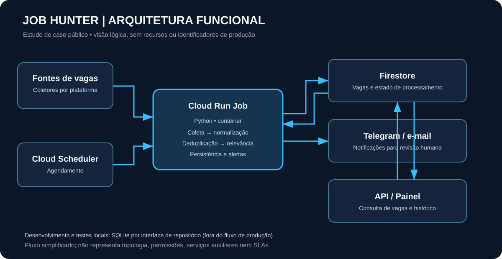
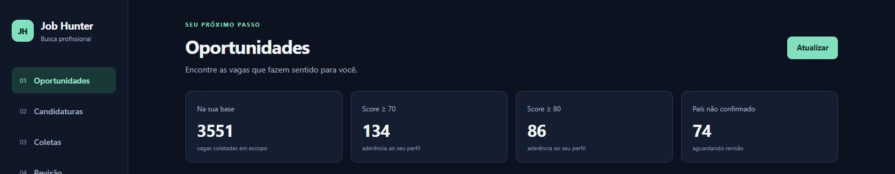
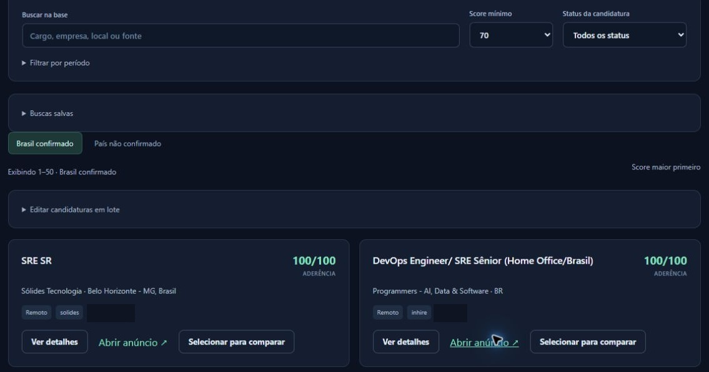
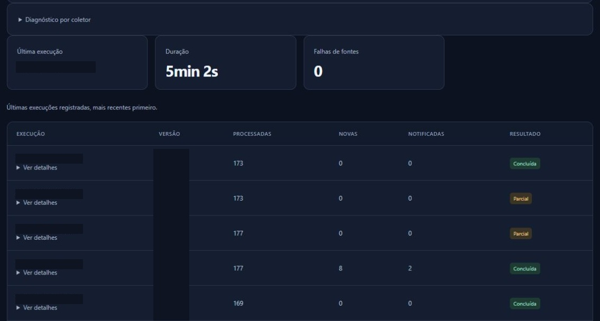
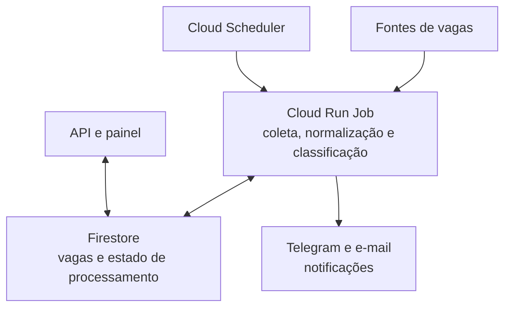

# Job Hunter — estudo de caso

Uma plataforma pessoal para coletar, organizar e priorizar oportunidades de infraestrutura, Cloud, DevOps, SRE e DevSecOps. O projeto combina automação em Python com serviços gerenciados do Google Cloud para executar buscas agendadas, manter o histórico e enviar alertas das vagas que merecem atenção.

> Este repositório apresenta a arquitetura, decisões e evidências do projeto Job Hunter. O código completo e o ambiente de produção são privados.

## Visão visual da arquitetura

O diagrama apresenta o fluxo lógico da solução, incluindo coleta, execução programada, persistência e alertas. Ele foi elaborado com base na documentação técnica do projeto, sem revelar recursos, credenciais ou topologia privada.

## Dashboard em produção

As imagens mostram o painel em uso em 18 de novembro de 2026. Os recortes preservam os indicadores e controles da interface. Informações individuais de candidatura e detalhes operacionais foram ocultados.

### Visão geral

Os indicadores resumem a base de vagas, as faixas de aderência e as oportunidades cujo país ainda precisa de confirmação.

### Filtros e classificação

A captura de 18 de novembro mostra a triagem por score. Desde a v0.34.84, o painel também filtra por data de descoberta, coletor e modalidade, ordena por recência ou aderência e guarda essas combinações em buscas salvas.

### Acompanhamento das coletas

O histórico mostra a duração da última coleta, falhas por fonte e o resultado das execuções recentes, com contagens de vagas processadas, novas e notificadas.

## O problema

Buscar vagas em várias fontes dá trabalho e facilita perder oportunidades. O Job Hunter automatiza parte desse fluxo: consulta fontes configuradas, normaliza os dados, evita duplicidades, aplica critérios de relevância e envia notificações para revisão humana.

A ferramenta apoia a busca; não se candidata automaticamente e não decide se uma vaga é adequada sem revisão da pessoa.

## Arquitetura

O desenho é uma visão funcional. A disponibilidade e o formato de cada fonte externa podem mudar; falhas de uma fonte precisam ser tratadas separadamente para não ocultar os resultados das demais.

## O que o projeto demonstra

- Execução agendada de workloads Python em contêiner no Google Cloud.
- Persistência por uma camada de repositório: SQLite para execução local e testes, Firestore para a execução em nuvem.
- Integração de notificações e uma API/painel para consulta.
- Normalização, deduplicação e pontuação orientada ao perfil de infraestrutura, Cloud, DevOps e SRE.
- Decisões de integração documentadas para fontes como Solides e Recrutei, considerando acesso real do runtime.
- Uso de testes, análise estática, auditoria de dependências e pipeline de contêiner.
- Separação por módulos para coletores, regras de negócio, persistência, API, painel e notificações.
- Avaliação crítica de qualidade: comparação entre regras e classificação assistida por IA, com validação de evidências e revisão humana.

## Minha contribuição

Desenhei e implementei o Job Hunter como projeto pessoal. Separei a coleta em lote da API para manter responsabilidades e verificações de saúde distintas. Na operação, implementei diagnósticos por fonte e um pipeline que publica imagens por digest, testa a coleta e valida o painel autenticado.

## Evidências de operação

| Evidência | O que foi observado |
|---|---|
| **Recuperação de deploy** | Na v0.34.81, o smoke test da API rejeitou a divergência entre a versão esperada e a reportada por `/health`. O pipeline executou o rollback. A v0.34.82 alinhou as versões e passou nos smoke tests do Job e da API. |
| **Segredos em runtime** | Após a migração da Doc9 para o Secret Manager, uma execução da v0.34.82 coletou 8 vagas da Doc9 e 3 da nova fonte InHire/Zallpy. Ambas concluíram com sucesso. |
| **Falha parcial de coleta** | Uma execução da v0.34.84 processou 169 vagas, com 2 novas, 167 atualizadas, 1 erro de fonte e 1 aviso. O resumo manteve as ocorrências visíveis junto às contagens. |

Os números descrevem execuções específicas. [Relato técnico do rollback](docs/technical-decisions.md#imagem-imutável-smoke-test-e-rollback).

## Resultados e limites da avaliação

Em um experimento offline exploratório com 20 casos, o baseline de regras classificou 14/20 casos como esperado. Uma versão inicial do prompt Gemini classificou 12/20. Uma iteração posterior, com prompt e perfil ajustados, produziu 15/20 respostas estruturalmente válidas; 11/20 também concordaram com a avaliação humana.

Esses números descrevem um conjunto pequeno de teste, não uma métrica de precisão representativa. A classificação por IA não foi promovida para substituir o filtro de produção. Os casos e dados de avaliação não são publicados.

## Decisões e controles

- **Execução:** Cloud Run Jobs para tarefas em lote; Scheduler para disparo programado.
- **Persistência:** Firestore para armazenar vagas e controlar atualizações.
- **Entrega:** notificações para permitir revisão humana antes de qualquer candidatura.
- **Identidade do CI/CD:** desenho baseado em GitHub Actions com OIDC/Workload Identity Federation, sem chave JSON de longa duração.
- **Segredos:** mantidos fora do repositório, no Secret Manager e em configurações protegidas.
- **Deploy:** publicação por digest imutável, smoke tests para o Job e a API e rollback em caso de falha.

Mais detalhes: [tour pela estrutura do código](docs/code-tour.md), [arquitetura](docs/architecture.md), [decisões técnicas](docs/technical-decisions.md), [estratégia das fontes](docs/source-strategy.md), [qualidade e avaliação](docs/quality-and-validation.md), [segurança](docs/security.md).

## Estado do estudo de caso

Este repositório é um estudo de caso com trechos de código representativos e sanitizados. Ele não contém o código-fonte completo, credenciais, dados pessoais, banco de vagas ou arquivos de avaliação. Os trechos não formam uma demonstração executável. As capturas documentam a interface em uso. O diagrama apresenta a arquitetura funcional com base na documentação.

O projeto continua sendo revisado. Os resultados acima são exploratórios, e itens de qualidade e operação seguem sujeitos a validação no ambiente privado. Este case não afirma disponibilidade, cobertura completa das fontes ou precisão garantida.

## Para candidaturas

Use este repositório quando o formulário pedir um projeto específico. Se pedir apenas o perfil, use [github.com/carlhenrike](https://github.com/carlhenrike).

