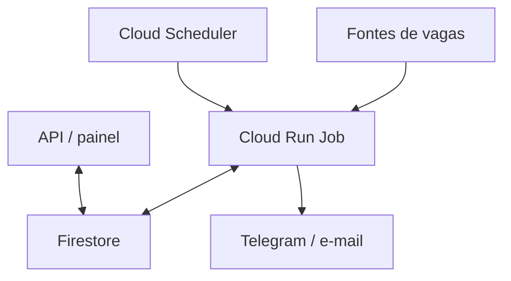

# Arquitetura

## Fluxo funcional

1. O Cloud Scheduler dispara o Cloud Run Job conforme a agenda configurada.
2. O Job consulta as fontes configuradas e transforma os registros para um modelo comum.
3. A aplicação tenta identificar vagas repetidas e atualizações, aplica critérios de relevância e persiste o estado no Firestore.
4. O Job envia notificações para que a pessoa revise os resultados.
5. A API e o painel leem os dados persistidos para consulta.

A falha ou indisponibilidade de uma fonte não deve ser confundida com uma execução sem vagas. O tratamento operacional precisa preservar esse contexto e tornar a falha visível.

## Persistência

A aplicação separa o fluxo de negócio do banco por meio de um contrato de repositório. SQLite é usado no desenvolvimento local e nos testes; Firestore atende à execução em nuvem.

## Componentes

| Componente | Responsabilidade |
|---|---|
| Fontes de vagas | Fornecer anúncios conforme disponibilidade e formato de cada plataforma |
| Cloud Scheduler | Iniciar a execução agendada |
| Cloud Run Job | Coleta, normalização, deduplicação, classificação e notificações |
| Firestore | Persistir anúncios e estado de processamento |
| API e painel | Consultar vagas armazenadas |
| Telegram e e-mail | Entregar alertas para revisão humana |

## Limites e dependências

- As fontes podem alterar páginas, limites, autenticação ou disponibilidade sem aviso.
- A deduplicação depende da qualidade dos identificadores e URLs fornecidos pelas fontes.
- O score serve para priorização, não é uma decisão de contratação nem garantia de aderência.
- A automação reduz tarefas repetitivas, mas a leitura da descrição e a candidatura permanecem humanas.
- O desenho abaixo é intencionalmente lógico; não expõe nomes de recursos, projetos, contas ou topologia privada.

## Diagrama

